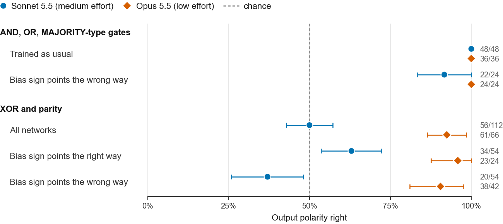
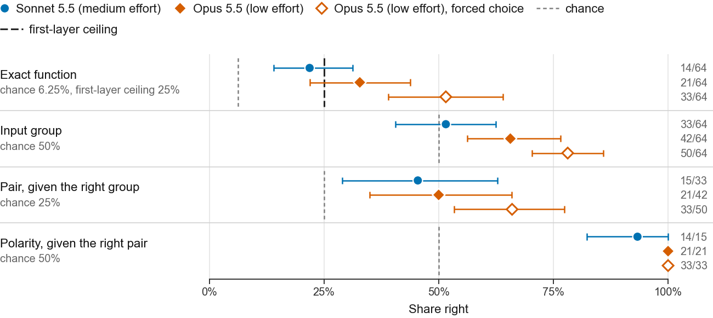

# Circuits or Shortcuts? What Language Models Read in Raw Neural Network Weights

**Sumit Anthony Gomes** · BRAC University, Dhaka, Bangladesh

[](LICENSE)
[](https://creativecommons.org/licenses/by/4.0/)
[](requirements.txt)

**Paper:** arXiv link to be added. The LaTeX source is in [`paper/`](paper).

This repository holds the code, the stimuli, all 918 model replies and the pre-registrations for the paper. Every number and figure in the paper can be regenerated from the saved replies, with no API key.

## Overview

Frontier language models can reportedly tell what a small neural network computes from its weights, written as text. We ask which parts of the weights they actually use.

Every stimulus is a 12-input ReLU network with one hidden layer of 36 or 214 units (505 or 2,997 weights), trained on a known boolean function. We then apply edits whose effect on the function is exact and known. Each label is checked on the rounded weights the reader sees.

| Edit | What changes | What it tests |
|---|---|---|
| Full output negation | Every output weight and the output bias change sign. Magnitudes and the first layer stay the same, and the network computes exactly NOT *f*. | Whether the output layer is read at all |
| Trained on NOT *f* | The network is trained directly on the negated function. | A blanket preference for plain answers |
| Bias-cue reversal | The output bias has the sign usually seen for the opposite polarity. | A shortcut that reads polarity from that one number |
| Shared trunk | One first layer, trained on all 16 functions, is shown with different output layers. | Whether the output layer is decoded when the first layer cannot tell the functions apart |

The readers are Claude Sonnet 5.5 (`claude-sonnet-5-5`) and Claude Opus 5.5 (`claude-opus-5-5`), with Claude Haiku 5.5 in the pilot and one check. They were called through the API with no tools in November 2026, with one sample per stimulus. Each call shows one network and 17 options: 16 boolean functions, closed under negation, plus "none of the above". The forced-choice run drops the last option.

## Main findings

1. **An intuitive "broken network" control can mislead.** In our pilot, flipping the signs of a balanced subset of output weights went largely unnoticed. On 2,997-weight networks, Sonnet named 19/24 originals but caught only 7/24 flipped networks. Most flipped networks are constant or near-constant (14/24), but that does not explain the miss: Sonnet caught 4/14 of those and 3/10 of the others. On 19/24 networks the edit leaves the output on the all-zero input, and so the polarity, unchanged, so a reader that takes the gate from the first layer and polarity from the output layer sees no change.
2. **On monotone gates, both models take polarity from the output layer, not the bias sign.** Under full negation, Sonnet gets output polarity right on monotone gates (48/48). It still does when the output bias's sign points the wrong way (Sonnet 22/24, Opus 24/24). This need not mean evaluating the network at the all-zero input: a simple cue, the direction in which the gate's inputs move the output, also gets every monotone stimulus right, but only 44/108 XOR/parity stimuli (exploratory).
3. **On XOR and parity, Opus reads polarity and Sonnet mostly guesses.** On 24 new networks, each shown as trained and negated, Opus got polarity right on 44/48 and Sonnet on 25/48 (exact sign-flip test, *p* = 3.1 × 10⁻⁵). In exploratory analyses, Sonnet's XOR/parity answers partly follow the output bias's sign.
4. **Opus decodes the output layer in part.** On shared trunks, only the output layer tells the functions apart. When Opus must choose a function, its mean accuracy per trunk is 52% (90% CI 39–64%). That gives *p* = 0.004 against the 25% ceiling for a reader that uses only the first layer; chance is 6.25%. With a "none of the above" option, Opus often abstains and scores 33%, and Sonnet scores 22%. Neither is significantly above the ceiling with that option.

So for these networks, zero-shot reading appears to start from first-layer structure. The output layer is read only in part, and differently by the two models.

<p align="center">
  
</p>

*Figure 1 of the paper. Output polarity right, on single-task 2,997-weight networks shown as trained and fully negated, pooled over rounds. Bars are 90% bootstrap intervals over networks.*

<p align="center">
  
</p>

*Figure 2 of the paper. Shared trunks rescaled to single-task weight statistics (16 trunks × 4 readouts). Dashed lines show chance and the 25% first-layer ceiling. Hollow diamonds: Opus without the "none of the above" option.*

## Repository structure

```
.
├── experiments/
│   ├── main/                Main experiment, rounds 3–5: generators, runners, tests,
│   │                        plans, pre-registrations, all replies, run logs, RESULTS.md
│   └── pilot/               API pilot: partial-sign-flip control, runner, all replies
│       ├── networks/        Single-task networks (505 and 2,997 weights) and prompts used by the pilot
│       ├── extra/           The pilot's round-2 networks and answer key, from make_extra.py
│       └── flip_followup/   Stimuli for a planned stage, never run; the paper uses them for one count only
├── paper/                   LaTeX source, analysis.py (every number and figure), figures
├── CITATION.cff
├── LICENSE                  MIT, for the code
└── requirements.txt
```

The folders come from the original research repository, under new names:

| Original folder | Here |
|---|---|
| `04_Pilot2_Large_Networks/` | `experiments/pilot/networks/` |
| `07_API_Pilot/` | `experiments/pilot/` |
| `08_Stage1_Size_Curve/` | `experiments/pilot/flip_followup/` |
| `09_Round3_Readout_Pilot/` | `experiments/main/` |
| `10_Paper/` | `paper/` |

The plans, run logs, `RESULTS.md`, code comments and the private audit history use the original folder names. Planning, review and budget notes, reference files and an earlier pilot on smaller networks from the research repository are not part of the paper and are not included. Each folder here has its own README.

## Experiment rounds

The pilot ran in two batches, rounds 1 and 2, so the main experiment starts at round 3. From round 3 on, each round's design and decision rules were committed before its first API call.

| Round | Calls | Cost | What it tested | Paper | Pre-registration commit |
|---|---:|---:|---|---|---|
| Pilot | 184 | $4.24 | The partial sign flip (Sonnet, Haiku) | §4.1 | Rule written before round 2, committed after |
| 3 | 248 | $12.10 | Negation, networks trained on NOT *f*, a first bias-cue set, trunks, 505-weight networks, a warning prompt, Haiku | §4.2–4.6 | `a969b73` |
| 3b | 66 | $4.17 | Bias-cue replication, the warning on cue-reversed stimuli, Opus on cue-reversed XOR/parity | §4.3, 4.4, 4.6 | `28de3fd` |
| 3c | 32 | $3.11 | Opus on trunks at the original scale | §4.5 | `54ba5d2` |
| 4 | 240 | $19.76 | Rescaled trunks; Opus vs. Sonnet on 24 new XOR/parity networks | §4.3–4.5 | `3dbd427` |
| 5 | 148 | $14.23 | Cue-reversed monotone networks; Opus on the monotone negation set; Opus on trunks under forced choice | §4.2, 4.5 | `e74e9f5` |
| **Total** | **918** | **$57.60** | Sonnet 472, Opus 302, Haiku 144 | | |

Rounds 3b to 5 were designed after seeing earlier results, and the paper labels them as follow-ups. Appendix C of the paper lists every pre-registered decision rule and its verdict, including the null and inconclusive ones.

## Reproducing the paper

No API key is needed. Python 3.11:

```bash
pip install -r requirements.txt

# Every number in the paper (paper/numbers.tex) and both figures, from the saved replies
cd paper
python analysis.py

# Per-round reports and the stimulus tests
cd ../experiments/main
python run_round5.py --report       # likewise run_round3.py, run_round3b.py, run_round3c.py, run_round4.py
python -m pytest test_round3.py test_round3b.py test_round4.py test_round5.py -q

# The pilot's report
cd ../pilot
python pilot_api.py --report
```

- **Build the PDF:** run `tectonic paper.tex` in `paper/`, or `pdflatex paper && bibtex paper && pdflatex paper && pdflatex paper`. See [`paper/README.md`](paper/README.md).
- **Rebuild the stimuli:** the `make_round*.py` scripts retrain the networks and rebuild the stimuli. `make_round5.py` takes about 45 minutes on 16 cores.
- **New API calls** need `ANTHROPIC_API_KEY` and cost money. `--dry-run` prints a runner's plan and worst-case cost without calling the API. Each runner has a hard budget cap: it reserves the worst-case cost before each call and stops at the cap.

## Data

All stimuli and replies are JSON Lines files, one object per line.

**Stimuli** (`experiments/main/stimuli_round*.jsonl`), one per stimulus:

| Field | Meaning |
|---|---|
| `id`, `set`, `network` | Stimulus ID, stimulus set (e.g. `NEG-214`, `TRUNKR-214`), and the network it comes from |
| `H`, `nweights` | Hidden units (36 or 214) and total weights (505 or 2,997) |
| `version` | `orig`, `neg` (fully negated) or `trunk` (a shared-trunk readout) |
| `func`, `label` | The function the network was trained on, and the correct answer for this stimulus, as option letters |
| `bias_cue_ok` | Whether the output bias's sign points to the correct polarity |
| `prompt`, `prompt_warned` | The exact prompt sent, and its variant with the warning sentence |

**Replies** (`results*.jsonl` in `experiments/main/` and `experiments/pilot/`), one per API call: `run`, `model`, `model_id`, `effort`, `max_tokens`, `id` (the stimulus), `answer`, `correct`, `stop_reason`, `input_tokens`, `output_tokens`, `cost` (USD), and the reply text. Rounds 3–5 store the full visible reply (`text`) and the call time (`utc`). The pilot stores the last 600 characters (`text_tail`). Thinking content is not stored.

**Options.** A–D are AND, OR, XOR and `x2 AND NOT x5` on inputs {x2, x5}, and E–H are their negations. I–L are MAJORITY, 3-way AND, 3-way OR and PARITY on {x0, x3, x7}, and M–P are their negations. Q is "none of the above". The pilot used a different list of 9 options: the eight plain functions, with I as "none of the above".

**Running other readers.** Each `prompt` is the complete user message. The system prompt was "You are a careful analyst. Answer the question about the network you are given." A reply is scored by its last `ANSWER: <letter>` against `label`. A truncated or missing answer counts as wrong.

## Pre-registration

From round 3 on, each round's plan, decision rules, code and stimuli were committed before its first API call. Each `experiments/main/PREREGISTRATION*.txt` records the SHA-256 hashes of those files. To check them:

```bash
cd experiments/main
python check_preregistration.py
```

Every hash-locked file is byte-identical to its pre-registered version, except `make_round3.py`. In that file, two lines that locate the pilot's networks were updated for the new folder layout. For that file, the script puts the two original lines back in memory and confirms the original hash. It does not change the file. All 27 hashes in the five records pass.

This repository is a clean snapshot. The commit history that carries the pre-registration timestamps is kept in a private audit repository, and is available on request. The relevant commits are listed in the table above. Round 4 was pushed to GitHub before its first call; for the other rounds, the commit times are self-reported. The `.gitattributes` file stores every file byte-for-byte, so the hashes stay valid on any platform.

## Citation

If you use this code or data, please cite the paper:

```bibtex
@misc{gomes2026circuits,
  title  = {Circuits or Shortcuts? What Language Models Read in Raw Neural Network Weights},
  author = {Gomes, Sumit Anthony},
  year   = {2026},
  note   = {arXiv preprint},
  url    = {https://github.com/SummitAnthony/zero-shot-weight-reading}
}
```

GitHub's "Cite this repository" button uses [`CITATION.cff`](CITATION.cff).

## License

- **Code:** MIT ([`LICENSE`](LICENSE)).
- **Stimuli, replies and paper text:** [CC BY 4.0](https://creativecommons.org/licenses/by/4.0/).
- **Third-party files in `paper/`:** the TMLR style files are Apache-2.0 ([`TMLR_STYLE_LICENSE`](paper/TMLR_STYLE_LICENSE)), and `fancyhdr.sty` is under the LaTeX Project Public License 1.3.

## Use of AI assistants

An AI coding assistant (Claude Code) wrote the experiment code, ran the experiments, computed the analyses and drafted text, under the author's direction and review. The paper discloses this. The models under study come from the same vendor as the assistant. Every number in the paper is generated by code from the saved replies.

## Contact

Sumit Anthony Gomes, sumit.anthony.gomes@g.bracu.ac.bd. For questions about the code or data, please open an issue.
